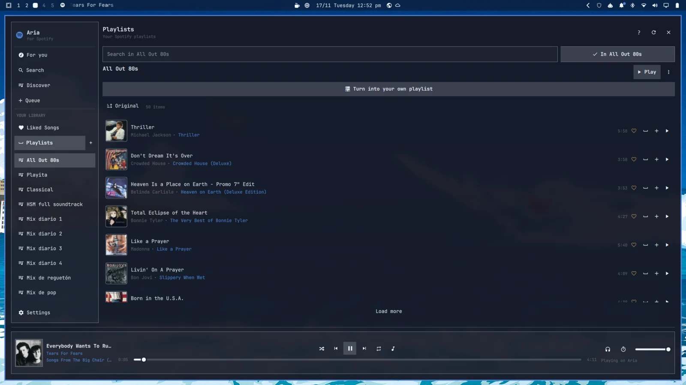
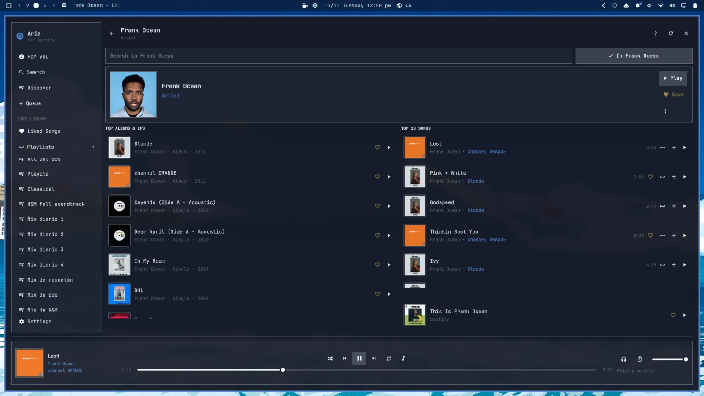
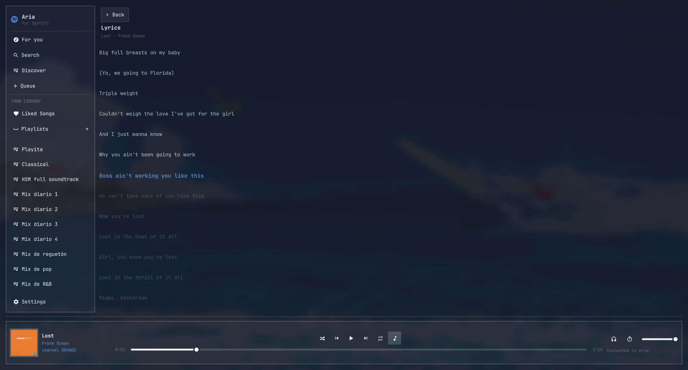
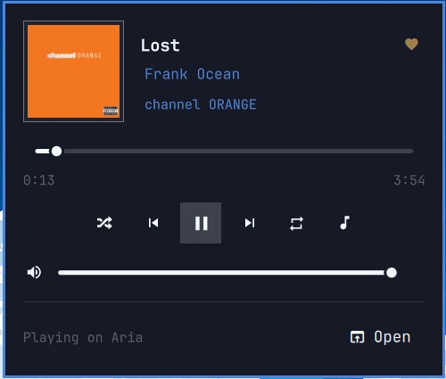
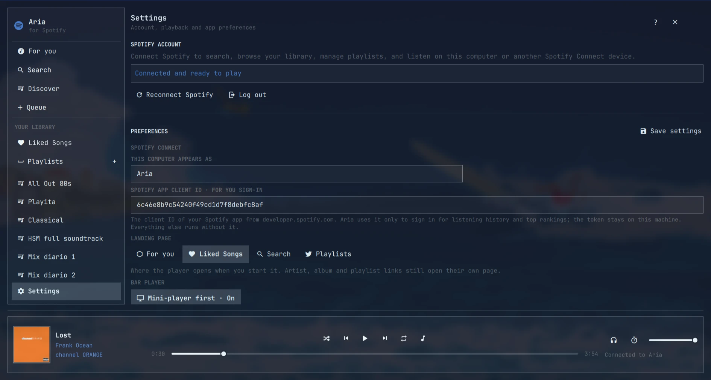

# Aria

**Spotify in Quickshell—not Chromium.**

Aria brings the Spotify experience you already know into a fast, beautiful
Omarchy plugin. It idles around **60 MB of RAM** instead of the roughly
**950 MB** the Spotify desktop client uses, follows your active Omarchy theme,
and keeps your music close with an integrated mini player.

Pair it with **Omasing** and lyrics for the song you are playing are fetched
for you, ready when you want them.

## Install

```bash
omarchy plugin add https://github.com/Greasydann/aria.git --enable
```

Requires Omarchy 4, a personal Spotify Premium account, and
[Soloist](#soloist-local-playback) for playback on this computer.

### Prepare the backend (required before the first login)

The plugin ships without a compiled backend, so run its bundled setup once
after installing. Spotify login and browsing use this private backend; until
it is installed, logging in explains exactly that instead of failing silently:

```bash
~/.config/omarchy/plugins/aria/scripts/setup.sh
```

Setup downloads the release binary for your architecture (x86_64 or aarch64),
checks its SHA-256 checksum and GitHub build attestation, and installs it
under `~/.local/lib/aria/`. If no verified release can be
downloaded, it falls back to a locked source build, which needs the Rust
toolchain pinned in `rust-toolchain.toml` (`rustup` fetches it), `cargo`,
and a network connection. Set `OMARCHY_SPOTIFY_BUILD_FROM_SOURCE=1` to skip
the download and build from source directly.

## Why you will love it

- **Lightweight by design.** Enjoy your music without keeping a browser-sized
  desktop client running.
- **Made for Omarchy.** Every color follows your current theme automatically,
  including light themes.
- **Always within reach.** Play, pause, skip, seek, change volume, or open
  lyrics from the mini player in your bar. Your last song stays loaded, so
  Play picks up where you left off even after the player has gone idle.
- **Your full music library.** Search Spotify, browse artists and albums,
  manage playlists and the queue, and move playback between Spotify Connect
  devices.
- **Lyrics with Omasing.** Open the current song in Omasing and let it find the
  right lyrics and playback position automatically.

## Familiar from the first click

The layout is inspired by the Spotify client, so there is almost nothing new
to learn. Your library and playlists live in the sidebar, search stays at the
top, the player stays at the bottom, and artist and album names take you
straight to their pages.

Every open starts on the same page — your Liked Songs — so closing the app
never leaves you on a half-remembered screen. Artist, album and playlist links
still open exactly where you pointed them.

Prefer to keep your hands on the keyboard? The whole app is designed for that
too.

| Shortcut | What it does |
| --- | --- |
| `Ctrl+F` or `/` | Search all of Spotify |
| `Ctrl+F` or `/` again | Toggle current area / all of Spotify |
| `Tab` / `F6` | Move between sidebar, search, the song list, and the player |
| `Arrow keys` | Move to a control; Enter activates |
| `C` | Row actions; arrows or Enter choose |
| `Space` | Play or pause |
| `Ctrl+Left` / `Ctrl+Right` | Previous or next song |
| `Shift+Left` / `Shift+Right` | Seek 10 seconds |
| `Ctrl+Up` / `Ctrl+Down` | Change volume |
| `M` | Mute or restore volume |
| `Ctrl+Shift+A` | Open the current song's artist |
| `Ctrl+Shift+B` | Open the current song's album |
| `Ctrl+/` | See every keyboard shortcut |
| `Ctrl+H` | Hide visible shortcut hints |

## See it in action

### Your playlists, instantly familiar

Everything is where you expect it to be—just faster, lighter, and dressed in
your Omarchy theme.



### Everything from an artist, in one view

Top albums and EPs sit beside the artist's ten biggest songs, with their
**This Is** playlist and full catalog only a search away.



### Sing along, line by line

Built-in lyrics follow the song in real time—no extra app, no browser tab.
The current line lights up as it plays, teleprompter style.



### A mini player that belongs in your desktop

The essentials are always one click away, without reopening the full app.



### Make it yours

Pick the page the player opens on—For you, Liked Songs, Search, Playlists, or
one specific playlist—then tune the bar player, artwork and keyboard hints to
taste.



## Log in with Spotify

Click the Spotify icon on the left side of the bar and choose **Log in**.
Sign-in finishes on Spotify's own website; if Spotify asks for a code, it is
shown in the player. The same login connects your library, search, and
playlists, and is remembered across restarts. Your password is entered only on
Spotify's own page—Aria never sees it, and your session is stored in a
permission-restricted file, not a keyring.

No Developer app, client ID, client secret, or callback URL is needed for this
login. A client ID is only required for one optional feature (see
[For you](#for-you)).

## Soloist: local playback

Aria routes playback on this computer through **Soloist**, a headless Spotify
Connect player. Your music plays through Spotify's own Connect service to a
receiver named **Aria**—the same way a Sonos or a phone would appear—with
Aria controlling it.

1. Install Soloist so `~/.local/bin/soloist` exists.
2. Create `~/.config/soloist/env` with your developer API key:
   `SOLOIST_API_KEY=<your key>`
3. Start it once and pair from any Spotify app:

   ```bash
   ~/.config/soloist/launch.sh --pair
   ```

   The launcher waits for the network, starts Soloist with the device name
   **Aria**, and waits for you to pick **Aria** in your Spotify app's device
   list.
4. Run it as a user service so it is always available:

   ```ini
   # ~/.config/systemd/user/soloist.service
   [Unit]
   Description=Aria Spotify playback receiver

   [Service]
   ExecStart=%h/.config/soloist/launch.sh

   [Install]
   WantedBy=default.target
   ```

   ```bash
   systemctl --user daemon-reload
   systemctl --user enable --now soloist.service
   ```

Aria's Settings page can also start and stop this receiver, and the device
picker shows every Spotify Connect speaker you own, so you can send the music
to another room's speaker from the same player.

## Keybindings

To give the **Super+Shift+M · Music** shortcut to Aria, add this to
`~/.config/hypr/bindings.lua`:

```lua
hl.unbind("SUPER + SHIFT + M") -- previously: Music
o.bind("SUPER + SHIFT + M", "Music (Aria)",
  "omarchy shell -q aria.player togglePlayer")
```

Run `hyprctl reload` after saving. In Aria's Settings, choose whether that
shortcut opens the full player or the mini player. Separate bindings can call
the same `aria.player` target directly:

```bash
omarchy shell -q aria.player playPause
omarchy shell -q aria.player next
omarchy shell -q aria.player previous
omarchy shell -q aria.player volumeUp
omarchy shell -q aria.player volumeDown
```

Volume steps are 5%, the same as Ctrl+Up / Ctrl+Down. These change Spotify's
own volume—including speakers—not the computer's output level.

## For you

The **For you** page shows your recently played songs and top songs and
artists. Spotify only serves those through a full-scope user token, so this
one page asks for a one-time extra login:

1. Create a Spotify app in the
   [developer dashboard](https://developer.spotify.com/dashboard) and add the
   redirect URI `http://127.0.0.1:8989/login`.
2. Paste the app's client ID into Aria's Settings.
3. Open **For you** and choose **Log in with Spotify**.

The refresh token is stored in `~/.local/state/aria/` (mode 600) and renews
itself; everything else in Aria keeps working without this login.

## More music, less app

- Discover Weekly, Release Radar, Daily Mixes, daylist, and more in **Discover**.
- Browse Liked Songs, saved albums, followed artists, podcasts, and books.
- Create playlists, add songs, reorder tracks, and turn followed playlists
  into your own editable copies when Spotify makes their contents available.
- Build a queue, start track radio, use shuffle and repeat, or set a sleep timer.
- Listen on this computer or switch to another Spotify Connect speaker or player.
- Choose the mini-player or full player independently for the bar icon and
  keyboard shortcut, use optional spinning vinyl artwork in the mini-player,
  show the title, artist, or both, and softly scroll overflowing text at an
  adjustable speed.

Want the details? Read the [technical notes](docs/TECHNICAL.md).

## Remove it completely

Run the bundled uninstaller from outside the plugin directory:

```bash
cd "$HOME" && "$HOME/.config/omarchy/plugins/aria/scripts/uninstall.sh"
```

It disables and removes the plugin, restarts the shell, and deletes
plugin-owned configuration, cached artwork, and session state. Your Soloist
installation and service are yours to keep or remove separately.

If the older shared `omarchy-spotify` files are present, the uninstaller asks
whether to remove them too (when run from a terminal); pass
`--include-shared` to decide up front. Aria removes them without asking only
when its install marker proves it created them.

Aria is an independent project and is not affiliated with Spotify.
Spotify is a trademark of Spotify AB. Aria is a fork of
[Omarchy Spotify](https://github.com/stappmus/Omarchy-Spotify) and would not
exist without it—thank you.

Licensed under the [MIT License](LICENSE).
